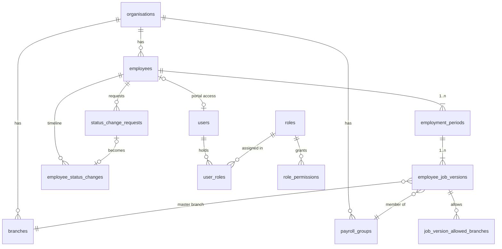

# Data Model — Package 1: Employee Master

Phase 3 artefact (SKILL.md §4). Status: **Approved at Gate 3, 22 November 2026.** Still to do: run against PostgreSQL (§14).
Inputs: DOMAIN_MODEL.md, STATE_MACHINES.md, PERMISSION_MATRIX.md (approved at Gate 2), BUSINESS_RULES.md, BRD v0.13, TSD v0.7.
The column-level definitions are the migration files in `backend/crates/db/migrations/` (0001–0007). This document explains them; where the two ever differ, the migrations are wrong and must be fixed, not this document silently.

---

## 1. Summary

- PostgreSQL 15 or later (Supabase), standard features only (TSD §17): tables, RLS, `daterange`, exclusion constraints (`btree_gist`), `NULLS NOT DISTINCT`.
- All objects live in one schema, `app`. Nothing is in `public`, so Supabase's default `anon` / `authenticated` grants never reach them.
- 35 tables: 3 platform, 10 org structure, 11 people, 9 identity and access, 2 audit/outbox. Table list in §4.
- Migrations are reversible SQLx pairs (`NNNN_name.up.sql` / `.down.sql`), run by the deploy pipeline (§9).

---

## 2. Tenant isolation

| Layer | How | Rule |
|---|---|---|
| Row-level security | Every client table has `org_id` and policy `tenant_isolation`: `org_id = app.current_org_id()` for both reading and writing. | TSD §4.1, INV-15 |
| Organisation per transaction | The API's first statement in every transaction is `SELECT set_config('app.org_id', <org from verified token>, true)` (and `app.user_id`). `true` = this transaction only, so it is safe with connection pooling. | TSD §4.1 |
| Fail closed | Not set ⇒ `current_org_id()` is NULL ⇒ no rows. A malformed value raises an error. | TSD §4.1 |
| Cross-organisation references | Every table has `UNIQUE (org_id, id)` and every foreign key between client tables is composite `(org_id, x_id)`. A row can never point at another organisation's row, even though FK checks ignore RLS. | INV-15 |
| No bypass | The API's role `app_api` is `NOBYPASSRLS` and owns nothing. Tables are owned by the migration role. | TSD §4.1 |
| Build check | `SELECT * FROM app.client_tables_without_rls()` must return no rows; CI fails otherwise. | TSD §4.5 |

**Before the organisation is known.** Three SECURITY DEFINER functions, each returning only an id:
- `org_id_for_short_code(code)`: employee sign-in (org short code + employee code + PIN).
- `org_id_for_admin_email(email)`: admin sign-in (needs platform-unique admin emails, DBQ-01).
- `active_org_ids()`: timed jobs fan out one task per organisation.

**Refresh tokens.** A refresh token is `<org_id>.<session_id>.<secret>`. The API sets the org from the token, reads the session (RLS limits it to that org) and compares the SHA-256 of the secret with `refresh_token_hash`. A token with a forged org finds no session and fails.

**Vendor.** `app_vendor` reads/writes `plans`, `organisations`, `vendor_users` only. It creates an organisation through `provision_organisation(...)` (§8), so it never needs rights on client tables. Support access to client data (VC-R6) is not in Package 1.

---

## 3. Database roles and environments

| Group role (NOLOGIN, in migration 0001) | Used by | Can do |
|---|---|---|
| `app_api` | API service and jobs | Client tables through RLS, with the grants in §7 |
| `app_outbox` | Outbox dispatcher | Read pending events of all organisations; mark them sent. Nothing else. |
| `app_vendor` | Vendor console | Platform tables; `provision_organisation` |

Group roles are cluster-wide, so dev, test and live share them. Isolation between environments comes from LOGIN roles that operations create per environment, outside migrations:

```sql
-- example for live; repeat with _test / _dev and the matching database
CREATE ROLE api_live LOGIN PASSWORD '<from Secret Manager>' IN ROLE app_api;
REVOKE CONNECT ON DATABASE payroll_live FROM PUBLIC;
GRANT CONNECT ON DATABASE payroll_live TO api_live, outbox_live, vendor_live, migrator_live;
```

`api_test` has no CONNECT on `payroll_live`, so a test service can't reach live data (TSD §16). DBQ-03 asks to confirm that Supabase supports separate databases in one project as TSD §16 assumes.

---

## 4. Tables

DB = enforced by the database. API = enforced by the Rust API (with tests).

### 4.1 Platform (migration 0002)

| Table | Purpose | Key rules |
|---|---|---|
| `plans` | Plans and whether they include the mobile app (MD-02) | Platform data, no org |
| `organisations` | Tenant root: short code, plan, employee limit, VC-01 behaviour, state | Short code `^[A-Z0-9]{2,6}$`, platform-unique (BR-OR-05) DB |
| `vendor_users` | Vendor staff, separate from client users | Email unique; only `app_vendor` can read |

### 4.2 Org Structure (0003)

| Table | Purpose | Key rules |
|---|---|---|
| `branches` | Branch, short code, time zone | Short code unique in org (BR-OR-01) DB; time zone must exist in `pg_timezone_names` (BR-OR-03) DB trigger |
| `departments`, `designations`, `categories`, `employee_types`, `exit_reasons` | Five lists, same shape (code, name, state) | Code unique in org, case-insensitive (BR-OR-01) DB. Never deleted (BR-OR-02): no DELETE grant |
| `contractors` | Contractor firms (EM-11) | Code unique in org DB |
| `payroll_groups` | Name, pay frequency, cycle definition, default flag | One default per org DB; cycle fields must match frequency DB; deletable only if never used (FK RESTRICT from job versions, SM-8) DB |
| `org_settings_versions` | OR-01..04 and EM-01..11 as one versioned JSON record per settings group | Insert-only. In force on D = latest `valid_from` ≤ D, then latest `recorded_at`. No row = defaults. Values validated by the core library (TSD §5.4) |
| `reference_name_history` | Every name a list entry, branch, contractor or payroll group has had | Filled by trigger on insert and rename; API read-only. Lets history show the name as it was (AC-OR-02.3) |

### 4.3 People (0004)

| Table | Purpose | Key rules |
|---|---|---|
| `employees` | Aggregate root: code, personal and contact details (current value only), portal access, enrolment status, `is_current` | Code unique in org and never updated (INV-01) DB. Mobile mandatory, E.164, unique among current employees (INV-07) DB. Portal access default `none` (EM-R15) DB |
| `employment_periods` | Joining date, probation end, last working day, exit reason and remarks | One open period per employee (INV-04) DB; periods never overlap DB; closed ⇒ last working day and exit reason present DB |
| `employee_job_versions` | Dated job fields (master branch, department, designation, category, type, contractor, manager, payroll group, enrolment ID) | Content never updated (BR-EM-05) DB via column grants. No two active versions of one employee overlap ⇒ one master branch and one payroll group per date (INV-02) DB. Enrolment ID held by one employee on any date (INV-08) DB. No gaps inside the period: API |
| `job_version_allowed_branches` | Allowed branches of a version (EM-06) | Written with the version, never changed. Master ∉ allowed (INV-03) API |
| `status_change_requests` | SM-2 lifecycle | One pending per employee (INV-05) DB. Decider ≠ raiser (INV-06) DB + API. SM-1 forbidden moves DB. Exit details required for → Exited DB. Reasons required for reject and cancel DB |
| `employee_status_changes` | Status timeline: one row per change, by start date | No overlap or gap by construction (status on D = latest start ≤ D). Insert-only except `superseded_at` for an Org Admin correction (SM-5) |
| `employee_code_sequences` | Running numbers per pattern key | Only increases (INV-12) DB trigger |
| `custom_field_definitions`, `custom_field_values` | Organisation-defined fields (EM-R8) | Key/value on purpose: the fields are defined by each organisation. One value column filled at most DB; type match API |
| `bulk_imports`, `bulk_import_rows` | SM-7 and row outcomes | Same file never applies a row twice: unique (org, checksum, row) for applied rows (AC-EM-15.5) DB |

### 4.4 Identity & Access (0005)

| Table | Purpose | Key rules |
|---|---|---|
| `users` | Admin and employee sign-in accounts | Employee user ⇔ employee id DB; one user per employee DB; exists only once portal access is granted (INV-16) API; admin email platform-unique DB (DBQ-01) |
| `user_credentials` | PIN or password hash, temporary expiry, failed attempts, lock time, TOTP secret (encrypted) | Stored SM-6 states: not issued, temporary, active, revoked. Locked and Expired are derived from `locked_until` and `temporary_expires_at` |
| `user_devices` | Registered phones (DEC-20) | Unique per user and device |
| `user_sessions` | Refresh-token sessions | Only the hash is stored. Index on live sessions for revoke-all (BR-EM-08) |
| `permissions` | Operation-code catalogue from PERMISSION_MATRIX | Platform data, seeded |
| `roles`, `role_permissions` | Built-in templates (org NULL, read-only) and each organisation's editable copies | Name unique per org DB. Fixed rules (🔒) API |
| `user_roles`, `user_role_scope_items` | Role assignment with scope: organisation / branches / departments (AC-07) | Last Org Admin, no wider grants than own (INV-13) API |

### 4.5 Audit and outbox (0006)

| Table | Purpose | Key rules |
|---|---|---|
| `audit_log` | Who did what, to which record, when, old/new values, reason, correlation id | Insert-only: no UPDATE/DELETE grant, and triggers refuse UPDATE, DELETE and TRUNCATE for every role (BR-EM-17) DB. Written in the same transaction as the change (INV-14) API |
| `outbox_events` | Events of DOMAIN_MODEL §7, written in the business transaction | API can only insert. Dispatcher marks sent. Payload = ids and dates only |

### 4.6 Relationships (core)



---

## 5. Effective dating and history

| Data | Model | "As on date D" |
|---|---|---|
| Job fields | `employee_job_versions.valid` (daterange, inclusive start). Corrections mark rows `superseded` (with `superseded_at`) and insert new ones; never edited | Active row whose range contains D. "As known on day K": rows recorded ≤ K and not superseded before K |
| Status | `employee_status_changes`: start date only | Latest non-superseded row with `effective_from` ≤ D |
| Employment | `employment_periods` | Period whose `[joining, last working day]` contains D |
| Settings | `org_settings_versions` | Latest `valid_from` ≤ D, then latest `recorded_at` |
| List and branch names | `reference_name_history` | Latest `valid_from` ≤ D |
| Personal / contact details | Current value only (DQ-06) | From `audit_log` old/new values |

All dates are calendar dates in the master branch's time zone. All timestamps are `timestamptz` (stored in UTC, TSD §5.3). There is no money in Package 1; NUMERIC is used only for custom number fields.

---

## 6. How the main flows write

| Flow | Rows written in one transaction (all also write `audit_log`) |
|---|---|
| Create employee | `employee_code_sequences` (locked, +1) → `employees` → `employment_periods` (open) → `employee_job_versions` (+ allowed branches) → `employee_status_changes` (Probation or Active) → outbox `EmployeeCreated` |
| Job change dated D | Mark affected active versions superseded; insert new versions from D, copying unchanged fields forward → outbox `JobChanged(D)` |
| Cancel scheduled job change | Version `state = cancelled` with reason |
| Raise / decide status change | `status_change_requests` insert / update. Approve with date ≤ today: also insert `employee_status_changes` → `effective`, outbox `StatusChanged` |
| Scheduled status reaches its date (00:15 branch time) | Same as approve-today, done by the job; safe to run twice (unique start date) |
| Exit takes effect | Status row `exited`; period closed with last working day and reason; last job version superseded by a copy ending on the last working day (frees the enrolment ID); `employees.is_current = false` (frees the mobile); credential revoked and sessions revoked → outbox `EmployeeExited` |
| Rejoin | `is_current = true` (mobile must still be free, DB checks); new open period; new job version; status row → outbox `EmployeeCreated` |
| Grant portal access | `employees.portal_access`; `users` insert or reactivate; credential `temporary` with hash and expiry. The PIN is shown once and emailed after commit; it is never stored or logged |
| Remove portal access | `portal_access = none`; user `revoked`; credential `revoked`; all sessions revoked |
| Wrong PIN | `failed_attempts + 1`; at 5, `locked_until = now() + 15 min` |

---

## 7. Privileges (what the API may change)

- **No DELETE** on any table except `role_permissions`, `user_roles`, `user_role_scope_items`, `custom_field_values` and unused `payroll_groups`. Everything else is deactivated, superseded, cancelled or revoked.
- **Column-level UPDATE** where history matters:
  - `employees`: not `id`, `org_id`, `employee_code`.
  - `employee_job_versions`: only `state`, `superseded_at`, `superseded_by_id`, `cancelled_reason`.
  - `employee_status_changes`: only `superseded_at`.
  - `status_change_requests`: only decision and cancel fields.
  - `org_settings_versions`, `audit_log`, `reference_name_history`: no UPDATE.
- **Optimistic locking:** mutable roots carry `row_version`. The API updates `… WHERE id = $1 AND row_version = $2` and adds 1. Zero rows updated ⇒ conflict (BR-EM-25).

---

## 8. Seed and reference data

| Data | Where | When |
|---|---|---|
| Permission catalogue (25 codes) | Migration 0007 | Every environment |
| Built-in role templates and their permissions | Migration 0007 | Every environment |
| Per-organisation: default payroll group "All employees, monthly", copies of the 4 built-in roles, 6 exit reasons, first Org Admin (invited) | `provision_organisation()` | When the vendor creates an organisation |
| Plans | Vendor console | Not seeded |
| Sector starter lists (G6) | Not in the database: offered at onboarding by the API from the core library (DBQ-04) | — |
| Test data | Separate script per environment, never real employee data (SKILL §7) | Dev/test only |

---

## 9. Migrations

| # | File | Contents |
|---|---|---|
| 0001 | foundation | Schema `app`, `btree_gist`, group roles, tenant helpers, RLS check function |
| 0002 | platform | Plans, organisations, vendor users |
| 0003 | org_structure | Branches, lists, contractors, payroll groups, settings versions, name history |
| 0004 | people | Employees, periods, job versions, status, sequences, custom fields, bulk import |
| 0005 | identity | Users, credentials, devices, sessions, roles, permissions, scopes; FKs from people tables to users |
| 0006 | audit_outbox | Audit log, outbox; sequence grants |
| 0007 | seed_and_functions | Permission and role seed; sign-in, job and provisioning functions |
| 0008 | api_support | Found in Phase 4: inactive dropdown options, probation reminder tracking, email one-time code, idempotency keys, export jobs. Approved at Gate 4 |
| 0009 | hardening | From the Supabase security advisor: fixed `search_path` on the 9 app functions that lacked one; `btree_gist` moved from `public` to `extensions`. No table or data change |

**Running.** The pipeline runs `sqlx migrate run` as the environment's migrator role. Before any change it checks `SELECT current_database()` against the target named in the deploy (`payroll_dev`, `payroll_test`, `payroll_live`) and stops on a mismatch (SKILL §3 Phase 3). Live migrations need manual approval (TSD §16).

**Reversibility.** Every migration has a `.down.sql`. Down migrations drop data, so they are for development databases only. 0006 down drops the audit log; it must never run on live. Package 2 and later changes are additive migrations (new tables, new nullable columns); a column is removed only by a separate, approved migration.

**Checks in CI (on a fresh database, every build):**
1. All migrations up, then all down, then up again.
2. `app.client_tables_without_rls()` returns no rows.
3. Organisation-isolation test (AT20): as `app_api` with org A set, every table returns no org B rows and every insert with org B's id fails.
4. Constraint tests for each DB-enforced invariant in §4 (overlap, one open period, one pending request, enrolment ID, mobile, sequence, audit immutability).

---

## 10. Indexes and query patterns

| Query | Index |
|---|---|
| Employee by code; list by name | `UNIQUE (org_id, employee_code)`; `(org_id, lower(full_name))` |
| Mobile clash check | partial unique `(org_id, mobile) WHERE is_current` |
| As-on-date job lookup; overlap check | GiST exclusion `(employee_id, valid) WHERE active` |
| Employees of a branch (scope) | `(org_id, master_branch_id) WHERE active` |
| Reporting chain (EM-R14) | `(org_id, reporting_manager_id) WHERE active` |
| Scheduled job changes and status changes due | `(org_id, lower(valid)) WHERE active`; `(org_id, state, effective_date) WHERE pending/scheduled` |
| Probation reminders | `(org_id, probation_end_date) WHERE open` |
| Audit trail of a record; audit by time | `(org_id, target_type, target_id, occurred_at)`; `(org_id, occurred_at)` |
| Pending outbox events | `(id) WHERE dispatched_at IS NULL` |

Package 1 tables stay small (thousands of rows per organisation). `audit_log` grows fastest: it is partitioned by month when it passes ~50 million rows (TSD §4.6); the index order above already starts with `org_id`.

---

## 11. Backup and recovery

- Supabase daily backups; point-in-time recovery from the Growth size (TSD §15). A restore into the test database is rehearsed every quarter, then the AT20 isolation test and row counts are run against it.
- Restores never go into live without approval. Client data copied to test is masked first (TSD §16).
- Losing the audit log is not acceptable: it is backed up with everything else, and nothing in the application can delete it.

---

## 12. Differences from earlier documents

| Document said | Now | Why |
|---|---|---|
| TSD §6: `employee_versions`, `employee_branches`, `employee_exits` | `employee_job_versions` + `job_version_allowed_branches`; exit details on `employment_periods` and the request | One job-version timeline (DOMAIN_MODEL §2.7) |
| TSD §6: `employee_credentials` | `user_credentials` | Only employees with portal access have a user (EM-R15) |
| TSD §6: `settings_history` | `org_settings_versions` | Versions are the history (G5) |
| DOMAIN_MODEL: StatusPeriod with from/to | `employee_status_changes` with start date only | Overlaps and gaps become impossible without edits |
| TSD §6 not listed | `reference_name_history`, `outbox_events` | AC-OR-02.3; DEC-03 |

TSD v0.7 updates §6 to these names.

---

## 13. Gate 3 questions — answered 22 November 2026 (proposed solutions accepted)

| ID | Question | Answer |
|---|---|---|
| DBQ-01 | Admin sign-in uses email only, so an admin email can belong to one organisation only. Someone who administers two client organisations needs two emails. | Accept. Alternative: admins also enter the org short code. |
| DBQ-02 | Custom monthly cycle start day (PL-01, e.g. 26th to 25th): allow 1–28 only? Days 29–31 don't exist in every month. | 1–28. |
| DBQ-03 | TSD §16 puts dev, test and live in one Supabase project as separate databases. Supabase's connection pooler and dashboard are built around one database per project. | Verify on the Supabase project before the first deploy. If it doesn't work cleanly, use a separate Supabase project for live. (Open action before first deploy.) |
| DBQ-04 | Sector starter lists (G6) are not seeded in the database; onboarding offers them from the core library. | Accept. |

---

## 14. Not yet verified

The migrations have not been run against a PostgreSQL server yet: none is installed on this machine. Gate 3 was approved on the design; the migrations must pass on an empty PostgreSQL 15+ database (with the CI checks in §9) before Phase 5 code relies on them.
